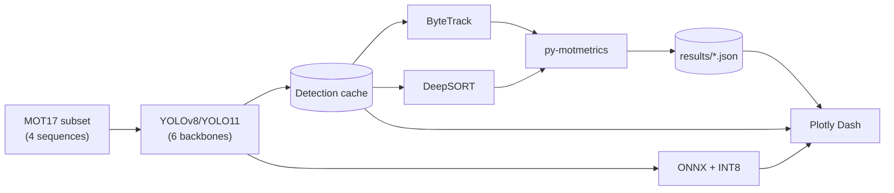

# Edge Multi-Object Tracking

[](https://github.com/fragompul/edge-multi-object-tracking/actions/workflows/ci.yml)
[](https://www.python.org/)
[](LICENSE)

Multi-object detection and tracking on real surveillance video
(**MOT17**): a **YOLOv8 vs. YOLO11** backbone speed/accuracy benchmark,
**ByteTrack vs. DeepSORT** identity-association comparison (both
implemented from scratch, not wrapped from an existing tracking
library), CPU edge-deployment export (**ONNX + INT8 quantization**), and
derived video analytics (trajectories, line-crossing counts, occupancy
heatmaps) -- explored through a **Plotly Dash** dashboard.

## Why this is hard

Detecting a person in a single frame is a solved problem. Tracking them
*consistently* across hundreds of frames, through occlusion, crowding,
and camera motion, is not -- an object detector alone has no notion of
identity from one frame to the next, and naive frame-to-frame matching
falls apart the moment two people cross paths or one is briefly hidden
behind another. This project treats detection and tracking as two
genuinely separate engineering problems, benchmarks each on its own
terms, and then measures what actually matters end-to-end: standard
CLEAR-MOT tracking metrics (MOTA, IDF1, ID-switch count) on real MOT17
footage, not a toy synthetic video.

## Architecture



Full component and sequence diagrams: [`docs/architecture.md`](docs/architecture.md).

## Installation & usage

```bash
python -m venv .venv && source .venv/bin/activate
pip install -e ".[dev,dashboard]"

# Download the 4-sequence MOT17 subset (public HF mirror, no auth needed)
python src/emot/data/download_mot17.py --output data/mot17

# Run detection once per (sequence, backbone) -- the expensive step,
# cached and reused by every downstream tracker (resumable, safe to
# Ctrl-C and rerun)
python src/emot/training/run_detection_cache.py

# Tune ByteTrack/DeepSORT thresholds with Optuna (val-split MOTA)
python src/emot/training/tune_trackers.py

# Run the full (sequence x backbone x tracker) benchmark grid
python src/emot/training/run_tracking_benchmark.py

# Explore results
python dashboard/app.py   # http://127.0.0.1:8050
```

## Results

See [`docs/results.md`](docs/results.md) for the full benchmark grid
(4 sequences x 6 backbones x 2 trackers) with discussion, and
[`docs/limitations.md`](docs/limitations.md) for the honest accounting
of every scope trade-off behind those numbers.

## Key Engineering Decisions

- **Detections are cached once per `(sequence, backbone)`, independent of
  which tracker consumes them.** Detection (a full YOLO forward pass) is
  the expensive step; tracking (Kalman + Hungarian matching) is cheap by
  comparison, so the benchmark grid reuses one detection pass across both
  trackers rather than re-running YOLO once per tracker.
- **Both trackers are implemented from the underlying primitives**
  (Kalman filter, IoU/Mahalanobis association, Hungarian assignment), not
  wrapped from an existing `bytetrack`/`deep_sort` package -- so the
  comparison is between this project's own understanding of the two
  algorithms' actual differences, not between two black boxes.
- **`py-motmetrics`' `iou_matrix` crashes outright under NumPy 2.x**
  (calls the removed `np.asfarray`) -- found while wiring up evaluation,
  fixed by reimplementing the ~10 lines of IoU-distance logic against
  this project's own tested IoU utility instead of patching the upstream
  library. Full diagnosis in the commit history.
- **Dynamic, not static, INT8 quantization** for the edge-export
  benchmark -- static quantization needs a calibration dataset pass,
  disproportionate setup for a benchmark about "what do you get for
  free." The accuracy cost is measured directly, not assumed away (see
  `docs/limitations.md`).
- **No separate frontend/backend split.** Unlike this portfolio's
  `industrial-visual-anomaly-detection` (FastAPI + React), this project's
  dashboard *is* Python (Plotly Dash), so there's no separate API service
  to keep in sync with a separate frontend build -- one codebase, one
  `pip install`.

## Why this matters

Every real deployment of a tracking system eventually has to answer the
same question this project's core comparison is built around: is a
motion-only tracker (fast, no extra model, but loses identity the moment
two people cross paths) good enough, or does the appearance-based
alternative's extra compute and complexity actually buy back enough
ID-switch reduction to justify it -- and does that answer change once you
also account for what edge deployment costs you in detector accuracy?
Building both trackers on shared primitives, benchmarking six detector
backbones under the same protocol, and quantifying the CPU-edge trade-off
directly is what turns that into a decision backed by numbers instead of
a framework's default choice.

## License

[MIT](LICENSE) for this repository's code. MOT17 is provided by the
MOTChallenge benchmark under its own license terms -- see [LICENSE](LICENSE).

## Author

**Francisco Javier Gómez Pulido**

*AI Lead @ AAPEX | Double Degree in Mathematics & Computer Science | Master's in Artificial Intelligence*

📫 **Let's connect:**
* **LinkedIn:** [linkedin.com/in/frangomezpulido](https://www.linkedin.com/in/frangomezpulido)
* **GitHub:** [github.com/fragompul](https://github.com/fragompul)
* **Email:** [frangomezpulido2002@gmail.com](mailto:frangomezpulido2002@gmail.com)

---
*If you find this repository interesting or useful, feel free to ⭐ star it!*
