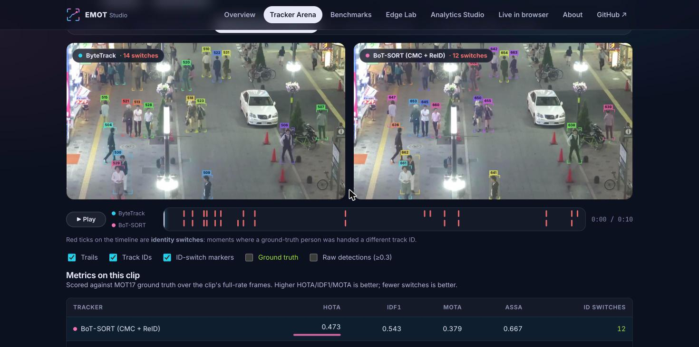
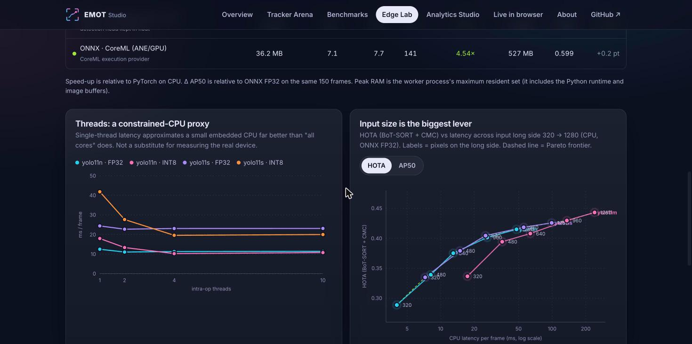
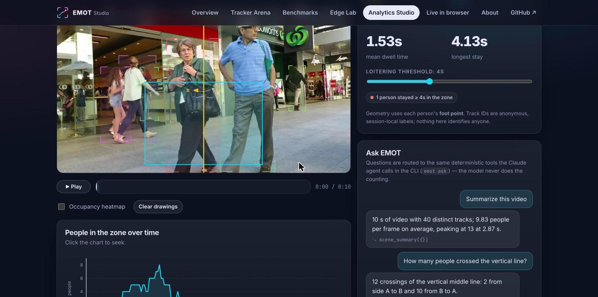
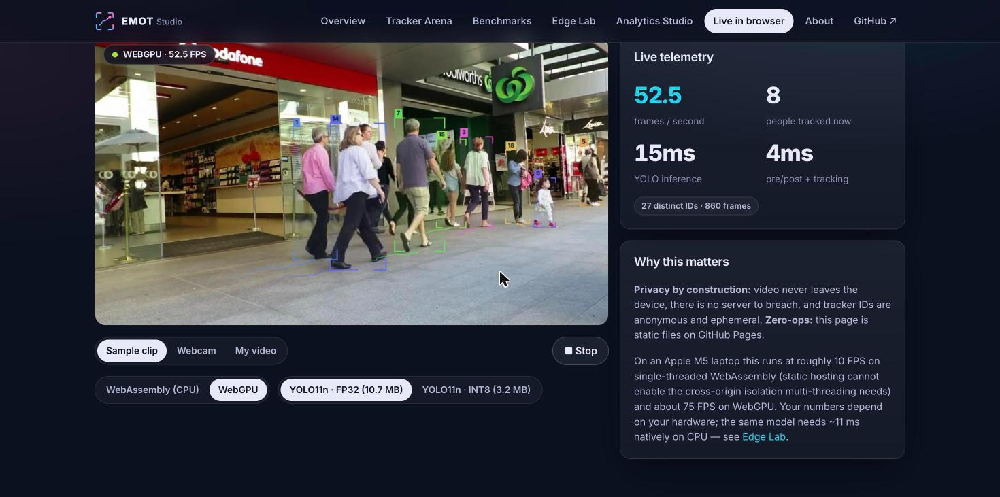
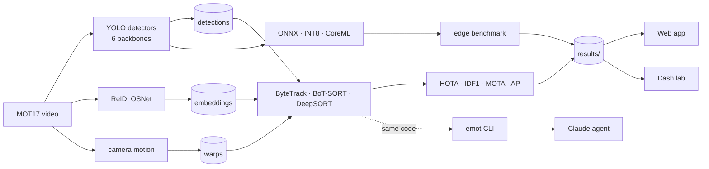

<p align="center">
  
</p>

<p align="center">
  <a href="https://github.com/fragompul/edge-multi-object-tracking/actions/workflows/ci.yml"></a>
  <a href="https://fragompul.github.io/edge-multi-object-tracking/"></a>
  <a href="https://fragompul.github.io/edge-multi-object-tracking/docs/"></a>
  
  
  <a href="LICENSE"></a>
</p>

<h3 align="center">
  Multi-object tracking built from scratch, benchmarked on real surveillance video,<br>
  squeezed through ONNX / INT8 / CoreML for the edge — and running <i>live in your browser</i>.
</h3>

<p align="center">
  <a href="https://fragompul.github.io/edge-multi-object-tracking/"><b>▶ Open the live web app</b></a> ·
  <a href="https://fragompul.github.io/edge-multi-object-tracking/docs/">Docs</a> ·
  <a href="docs/results.md">Results</a> ·
  <a href="docs/edge.md">Edge deployment</a> ·
  <a href="docs/experiments.md">Experiment log</a>
</p>

<p align="center">
  <br>
  <sub>Same detector, same video. <b>Left:</b> ByteTrack. <b>Right:</b> BoT-SORT with camera-motion compensation. Red rings mark identity switches, counted live.</sub>
</p>

## What is this?

A research-grade tracking stack with product-grade edges. **ByteTrack, BoT-SORT and DeepSORT are implemented from the underlying primitives** (Kalman filter, IoU / Mahalanobis / cosine association, Hungarian assignment, matching cascade, optical-flow camera-motion compensation, an OSNet ReID network written from the paper), compared on a controlled ladder over all 7 MOT17 training sequences and 6 YOLO backbones (**294 runs**), deployed with ONNX Runtime across CPU / INT8 / CoreML, and exposed through a CLI, a Plotly lab, a Claude-powered analytics agent and a static web app that runs the detector **in your browser tab**.

|  | |
| --- | --- |
| 🎯 **Tracking** | HOTA · IDF1 · MOTA · identity switches, a 7-variant ablation ladder (CMC, ReID, cascade) |
| ⚡ **Edge** | ONNX Runtime, static INT8, CoreML, thread scaling, input-size sweep — every row measured for latency, RAM **and** AP |
| 🧠 **Agent** | Ask *"how many people crossed the middle line?"* — Claude calls deterministic analytics tools; the model never counts |
| 🌐 **Browser** | YOLO11 + ByteTrack via ONNX Runtime Web (≈55–75 FPS on WebGPU, ≈10 on WASM, measured on an M5 laptop) — no upload, no server |
| 🔬 **Verified** | HOTA matches TrackEval to 10 decimals; OSNet matches an independent ONNX export (cosine 1.0); TypeScript ports are parity-tested against Python |

## Headline findings

<table>
<tr>
<td width="50%">

**Tracking** (mean over 7 scenes × 6 detectors)

| Tracker | HOTA | ID switches |
| --- | ---: | ---: |
| **BoT-SORT (CMC + ReID)** | **0.403** | **41** |
| BoT-SORT (CMC) | 0.395 | 44 |
| DeepSORT (OSNet + cascade) | 0.392 | 112 |
| ByteTrack | 0.386 | 56 |
| DeepSORT (ResNet18) | 0.351 | 140 |

</td>
<td width="50%">

- **Camera-motion compensation** removes **33%** of identity switches on moving-camera scenes — and does nothing on static ones.
- **A real ReID network** lifts DeepSORT by **+0.036 HOTA** over generic ImageNet features (same-person vs different-person separation d′ 1.75 → 4.30).
- **The matching cascade** cuts switches **34%** without touching detection quality.
- **Pixels beat parameters**: `yolo11n` at 960 px matches `yolo11m` at 640 px (HOTA 0.401 vs 0.408) at 2.4× lower CPU latency.

</td>
</tr>
</table>

<p align="center"></p>

### Edge deployment, measured honestly

<p align="center"></p>

- ONNX Runtime is **~1.4× faster than PyTorch on CPU** at identical accuracy; **CoreML is ~5.7× faster** on average (yolo11s: 32 ms → 7 ms).
- Static INT8 gives **~3.7× smaller weights**, but on this CPU only a small speed-up (and a *slowdown* on one thread). Operator profiling shows why.
- **A correction worth reading:** v1 of this project concluded ONNX was *slower* than PyTorch. That was a methodology error (PyTorch ran a 384×640 input, ONNX a padded 640×640: 1.67× more pixels). Found, fixed, [documented](docs/edge.md#the-correction-the-first-benchmark-compared-different-input-shapes).

## Try it

```bash
pip install -e ".[dev,dashboard,agent]"                      # Python 3.11+

emot track my_video.mp4 --tracker botsort --save out.mp4 --jsonl tracks.jsonl
emot track 0 --show                                          # webcam, live FPS + latency breakdown
emot ask tracks.jsonl "How many people crossed the middle line?" --offline
emot results                                                 # the full benchmark in your terminal
```

Reproduce everything (≈1 h on an Apple-silicon laptop, mostly unattended):

```bash
make data detect features tune bench edge figures web-data    # see `make help`
docker compose up dashboard                                   # or the containerised dashboard
```

<p align="center">
  
  
</p>
<p align="center">
  
  
</p>

## How it fits together



Everything expensive and tracker-independent is cached once, so a 294-run grid replays in minutes and an Optuna search takes seconds. More in [architecture](docs/architecture.md) and [methodology](docs/methodology.md).

## Engineering notes (the bugs are the interesting part)

- **HOTA validated against the reference implementation** to 10 decimals on a realistic scenario, rather than trusted.
- **OSNet verified three ways:** `strict=True` load of the authors' weights, cosine 1.0000 against an independent ONNX export, and measurable same/different-person separation.
- **A refactor proven behaviour-preserving:** vectorised DeepSORT gating checked against the old implementation from git — zero mismatching frames.
- **Static INT8 first scored AP 0.0** — the decode graph mixes pixel coordinates and probabilities in one tensor; keeping decode in float fixed it.
- **Cross-language parity tests caught an NMS bug** in the Python reference (OpenCV's `top_k` truncates candidates *before* suppression).

Full log, dead ends included: [docs/experiments.md](docs/experiments.md).

## Repository map

```
src/emot/   detection · reid · tracking · evaluation · benchmark · export · analytics · agent · pipeline · viz · cli
web/        React + TypeScript app, ONNX Runtime Web, cross-language parity tests
dashboard/  Plotly Dash lab          docs/   mkdocs site          scripts/   figures · GIFs · data export
tests/      unit + integration       results/  every number the docs and web app show
```

## Honest limits

Off-the-shelf COCO detectors (not fine-tuned), single-sequence tuning (held-out means reported), no distractor filtering — scores compare trackers *to each other*, not to MOTChallenge leaderboards. Edge numbers come from one machine and are hypotheses for yours. Person tracking is dual-use: IDs are anonymous and session-local by design, cross-camera re-identification is out of scope. See [limitations](docs/limitations.md) and [privacy & ethics](docs/privacy-and-ethics.md).

## Credits & licence

Code: [MIT](LICENSE). Detection uses Ultralytics YOLO (AGPL-3.0) and OSNet weights from the `torchreid` authors (MIT); video is **MOT17** © MOTChallenge (CC BY-NC-SA 3.0) — see [THIRD_PARTY_NOTICES.md](THIRD_PARTY_NOTICES.md). Algorithms: ByteTrack (Zhang et al.), BoT-SORT (Aharon et al.), DeepSORT (Wojke et al.), OSNet (Zhou et al.), HOTA (Luiten et al.).

## Author

**Francisco Javier Gómez Pulido** — *AI Lead @ AAPEX · Double Degree in Mathematics & Computer Science · Master's in Artificial Intelligence*

📫 [LinkedIn](https://www.linkedin.com/in/frangomezpulido) · [GitHub](https://github.com/fragompul) · [Email](mailto:frangomezpulido2002@gmail.com)

<sub>If this repo is useful or interesting, a ⭐ is much appreciated.</sub>
