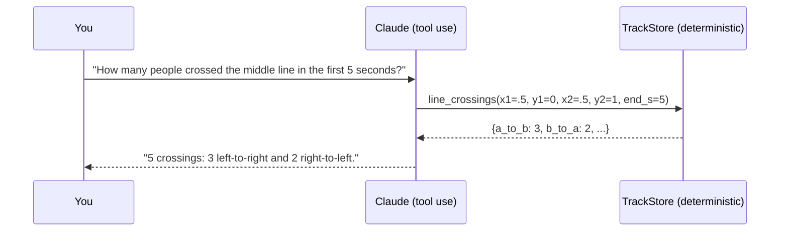

# Analytics & the natural-language agent

Tracking is a means; the product is *answers* -- how many people crossed, how long they stayed, when it got crowded.

## Scene analytics (`emot.analytics`)

All geometry uses each person's **foot point** (bottom-centre of the box): a head can overhang a zone edge, feet cannot.

| Capability | Function | Notes |
| --- | --- | --- |
| Trajectories | `build_trajectories` | centres, foot points, box heights per track |
| Line crossings | `crossing_events` | per-crossing events with frame, track, direction (side A/B from the line's orientation) |
| Zones | `Zone`, `point_in_polygon` | arbitrary polygons, even-odd rule |
| Dwell time | `dwell_stats` | seconds inside, number of entries, first frame |
| Loitering | `detect_loitering` | first frame a track exceeds `min_seconds` inside a zone |
| Crowding | `detect_crowding` | stretches with occupancy >= threshold for >= `min_seconds` |
| Motion | `motion_stats` | median speed in **body-heights per second** |
| Heatmap | `occupancy_heatmap` | 2D histogram of foot points |

**Why body-heights per second?** A person near the camera covers more pixels per step than a distant one walking just
as fast. Dividing by box height cancels the perspective scale without any camera calibration. A unit test checks that
the same walk at two scales gives identical speed.

## The agent (`emot.agent`)



**The model never counts.** Seven typed tools (`scene_summary`, `count_people`, `line_crossings`, `dwell_time`,
`crowding`, `busiest_moments`, `track_info`) compute every number; the model only chooses which to call and phrases the result.
That keeps every answer auditable -- the tool trace is returned with it -- and immune to arithmetic hallucination.
Arguments are normalised (0-1) so the model never needs the video resolution.

```bash
emot track clip.mp4 --tracker botsort --jsonl tracks.jsonl
export ANTHROPIC_API_KEY=...
emot ask tracks.jsonl "Who stayed in the left half the longest?" --fps 30 --width 1920 --height 1080 --trace
emot ask tracks.jsonl "How many people are there?" --offline      # no key needed
```

- `ask_claude` is a manual tool-use loop on the Anthropic SDK (default model `claude-opus-5-5`, low effort, no forced tool
  choice, assistant turns passed back unchanged, refusals surfaced).
- `ask_offline` is a rule-based router onto the *same* tools -- it powers the CI tests and the browser demo, and is an
  honest baseline for what the LLM adds (free-form phrasing, multi-step questions).
- Both the tools and the planner exist in Python and TypeScript, kept in agreement by parity fixtures.
