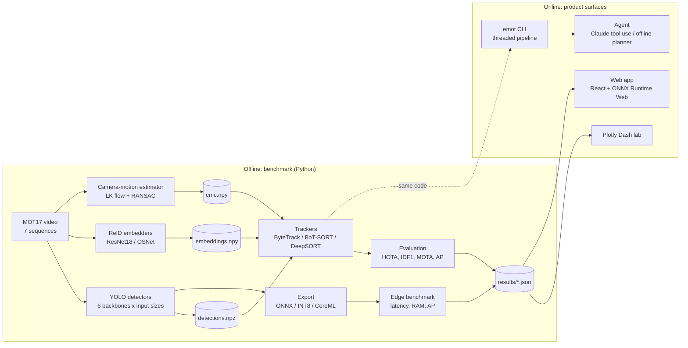
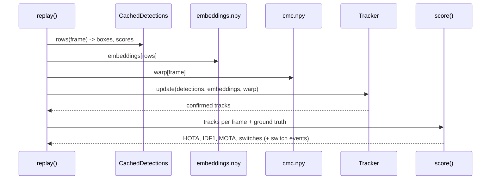
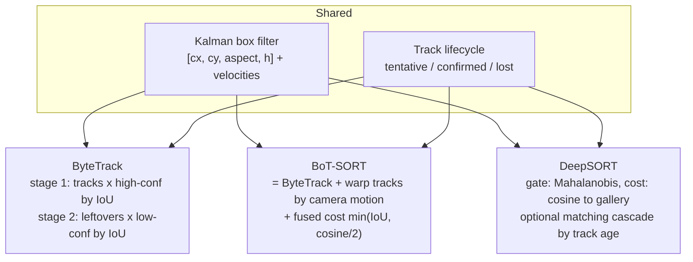

# Architecture

## System overview



## Design principles

1. **Cache everything that doesn't depend on the thing you're varying.** Detection is the expensive
   step and is independent of the tracker; embeddings and camera motion are independent of the
   association logic. Caching them turns a 294-run grid into minutes and an Optuna search into seconds.
2. **One interface per concern.** `Detection`, `Embedder`, `OnlineTracker`, `TrackStore` are small
   and stable, so a fake can stand in for any of them in tests.
3. **No black boxes in the comparison.** Trackers are implemented from the primitives; the
   only wrapped component is `py-motmetrics` for CLEAR-MOT (a standard with subtle edge cases),
   and even there the IoU distance is local because the upstream one crashes on NumPy 2.
4. **Two implementations are better than one when you test them against each other.** The browser
   runs TypeScript ports verified against Python fixtures; HOTA is verified against TrackEval;
   the ONNX detector against PyTorch; OSNet against an independent ONNX export.

## Replaying a tracker from caches



## Tracker anatomy



## Edge pipeline (live)

`emot track` runs three threads joined by bounded queues -- capture, detect+track, annotate/write --
so a slow stage applies back-pressure on files and sheds the stalest frame on live sources.
The detector is either Ultralytics (PyTorch) or `OnnxPersonDetector`: ONNX Runtime with an explicit
execution provider, thread budget and Python-side letterbox/decode/NMS that the browser port mirrors.

## Web app

A static React + TypeScript site (no backend): precomputed clips/tracks/results as JSON and MP4,
analytics and tracking computed client-side, YOLO11n via ONNX Runtime Web (WebGPU or WASM).
Details in [Web app](web-app.md).

## Repository layout

```
src/emot/
  data/        MOT17 download + loader
  detection/   Ultralytics wrapper, ONNX Runtime detector (letterbox/decode/NMS)
  reid/        OSNet (from the paper) + embedders
  tracking/    kalman, bytetrack, botsort, deepsort, cmc, online facade
  evaluation/  HOTA, detection AP, CLEAR-MOT wrapper
  benchmark/   caches, replay, aggregation
  export/      ONNX export, INT8 quantisation, isolated edge worker
  analytics/   trajectories, zones, dwell, loitering, crowding
  agent/       analytics tools, Claude tool-use loop, offline planner
  pipeline/    sources + threaded real-time pipeline
  viz/         renderer, palette, figures
  training/    runnable stages (detect, features, tune, bench, edge)
  cli.py       `emot` command
web/           React/TypeScript app (+ cross-language parity tests)
dashboard/     Plotly Dash lab
docs/          this site (mkdocs-material)
scripts/       figure / GIF / data-export generators
```
