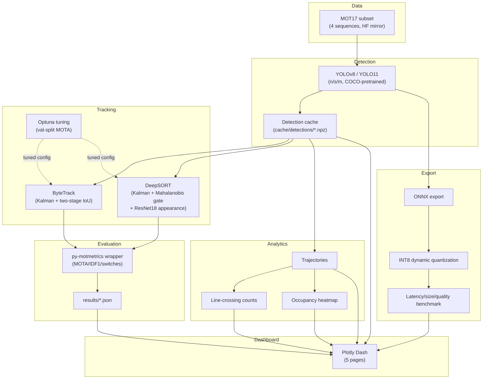
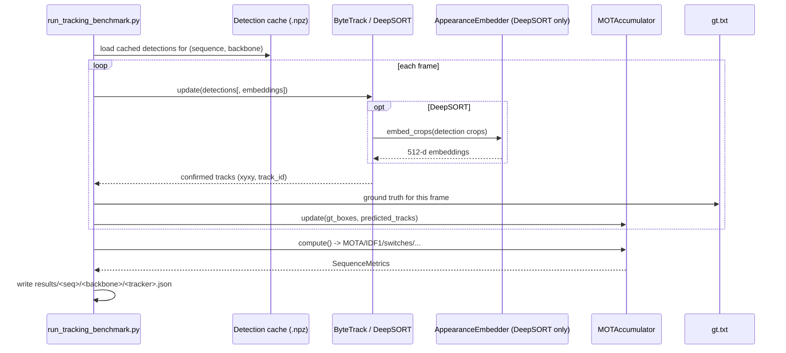

# Architecture

## Component overview



## Why detections are cached separately from tracking

Detection (a full YOLO forward pass per frame) is the expensive step;
tracking (Kalman prediction + Hungarian assignment) is cheap by
comparison. The benchmark grid is `sequences x backbones x trackers`, but
which tracker runs downstream has no effect on what the detector
produces -- so `run_detection_cache.py` runs `sequences x backbones`
detection passes once, and `run_tracking_benchmark.py` replays the cached
detections through both trackers, roughly halving the total detection
compute versus re-running YOLO once per tracker. The dashboard's
Sequence Explorer and Analytics pages also read directly from this cache,
so exploring the data doesn't require the detector to be loaded at all.

## Inference/evaluation sequence (one benchmark cell)



## Repository layout

Deliberately different from this portfolio's
`industrial-visual-anomaly-detection` (which splits into a FastAPI
backend + a separate React frontend service): this project is a single
Python codebase, since a Dash app *is* Python and doesn't need a separate
API service to talk to a separate frontend build.

```
src/emot/
  data/         MOT17 downloader + sequence/ground-truth loader
  detection/    YOLO wrapper + backbone specs
  tracking/     Kalman filter, IoU, Track lifecycle, ByteTrack, DeepSORT, ReID embedder
  evaluation/   py-motmetrics wrapper
  export/       ONNX export, INT8 quantization, latency/size/quality benchmark
  analytics/    trajectories, line-crossing counting, occupancy heatmap
  training/     detection-cache runner, Optuna tuning, full benchmark grid runner
dashboard/
  app.py        Dash app shell (navbar + page container)
  data_loader.py  shared read-only access to results/cache for every page
  pages/        one module per page (overview, backbone benchmark, tracker
                 comparison, sequence explorer, analytics)
tests/
  unit/         no external downloads, run in every CI job
  integration/  real YOLO11n checkpoint, isolated into its own CI job
notebooks/      EDA + figure generation only, no business logic
docs/           this document, methodology, experiments, limitations, results
```
