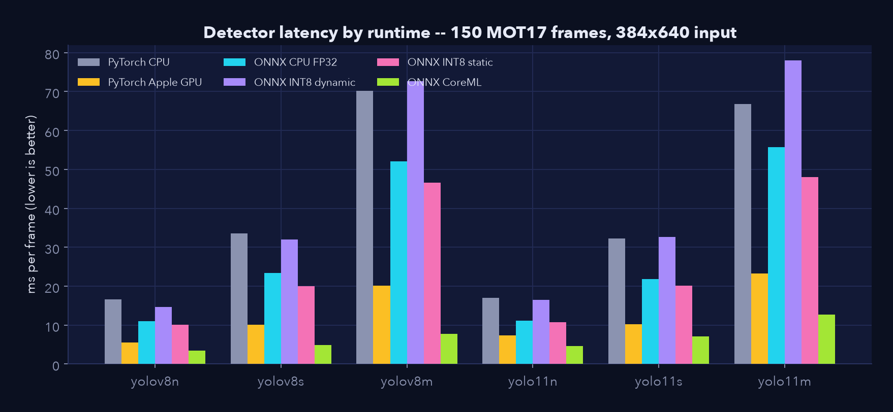
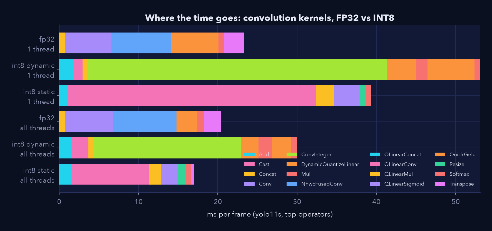
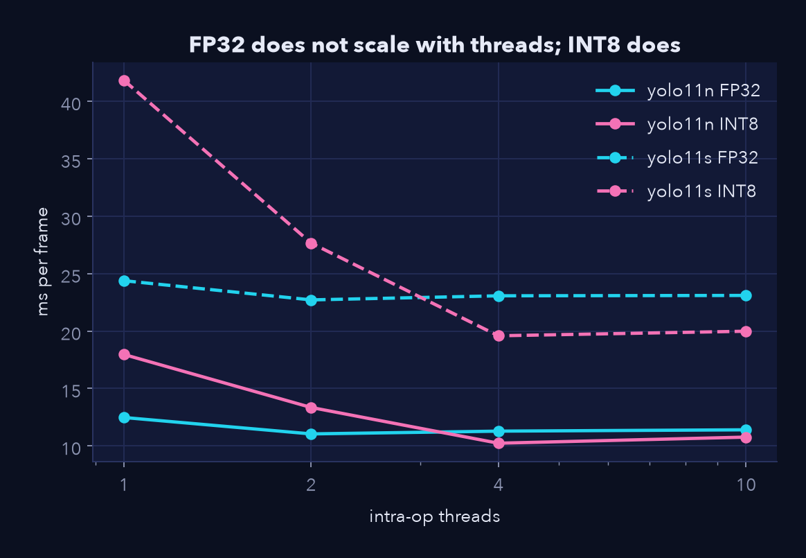
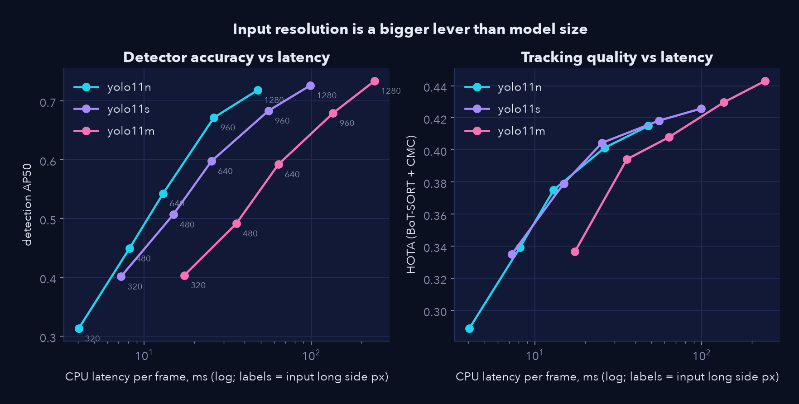

# Edge deployment

!!! note "Generated, not typed"
    Computed by `scripts/make_results_docs.py` from `results/edge_benchmark.json`
    (`make edge`, then `scripts/profile_onnx_ops.py`).

## Protocol

- **Machine:** Apple M5 (10 cores), macOS-26.6.2-arm64-arm-64bit, PyTorch 2.14.1, ONNX Runtime 1.31.0.
- **Frames:** 150 real MOT17 frames (25 from each of six 1080p sequences), identical for every configuration.
- **Isolation:** every configuration runs in its own process (`emot.export.edge_worker`), so latency, peak memory and
  accuracy belong to exactly one configuration.
- **Accuracy is measured, not proxied:** every row is scored with COCO-style AP against ground truth.
- **Input:** 16:9 rectangular static shape (384x640 for the default size), the shape PyTorch's own rectangular
  inference uses -- see the correction below.
- **Calibration** for static INT8 uses 66 frames that are disjoint from (and at least 4 frames away from) every evaluation frame.
- **Not measured:** power (needs root), and any device other than this laptop. Treat absolute numbers as this machine's, ratios as hypotheses for yours.

## The correction: the first benchmark compared different input shapes

The original version of this project reported that ONNX was *slower* than PyTorch (about 1.5-2x) and that INT8 did not help.
Re-examining it found a methodology error: PyTorch inference through Ultralytics pads a 16:9 frame only to the stride
grid (384x640), whereas the ONNX export used a 640x640 square -- **1.67x more pixels** for the same image. With
matched shapes, ONNX Runtime on CPU is **1.41x faster than PyTorch on average**. The lesson is general:
match the exported shape to the camera before comparing runtimes. (The old benchmark script was removed; see
[Experiments](experiments.md).)

## Results per backbone

### yolo11n
| Runtime | Size (MB) | Mean ms | p95 ms | FPS | Speed-up vs PyTorch CPU | Peak RAM (MB) | AP50 | Δ AP50 vs FP32 |
| --- | ---: | ---: | ---: | ---: | ---: | ---: | ---: | ---: |
| PyTorch CPU | 5.4 | 17.0 | 17.3 | 59 | 1.00x | 470 | 0.543 | +0.0 pt |
| PyTorch Apple GPU (MPS) | 5.4 | 7.4 | 11.9 | 135 | 2.29x | 622 | 0.543 | +0.0 pt |
| ONNX Runtime CPU FP32 | 10.2 | 11.2 | 12.4 | 89 | 1.52x | 453 | 0.543 | +0.0 pt |
| ONNX INT8 dynamic | 2.8 | 16.5 | 18.4 | 60 | 1.03x | 420 | 0.540 | -0.3 pt |
| ONNX INT8 static (QDQ) | 3.1 | 10.8 | 13.1 | 92 | 1.57x | 398 | 0.529 | -1.4 pt |
| ONNX INT8 static, FP32 head | 3.2 | 11.3 | 13.8 | 89 | 1.51x | 396 | 0.530 | -1.2 pt |
| ONNX CoreML (ANE/GPU) | 10.2 | 4.6 | 4.8 | 217 | 3.69x | 435 | 0.542 | -0.1 pt |

### yolo11s
| Runtime | Size (MB) | Mean ms | p95 ms | FPS | Speed-up vs PyTorch CPU | Peak RAM (MB) | AP50 | Δ AP50 vs FP32 |
| --- | ---: | ---: | ---: | ---: | ---: | ---: | ---: | ---: |
| PyTorch CPU | 18.4 | 32.2 | 32.9 | 31 | 1.00x | 557 | 0.598 | +0.0 pt |
| PyTorch Apple GPU (MPS) | 18.4 | 10.2 | 12.4 | 98 | 3.16x | 661 | 0.598 | +0.0 pt |
| ONNX Runtime CPU FP32 | 36.2 | 21.9 | 23.4 | 46 | 1.47x | 563 | 0.598 | +0.0 pt |
| ONNX INT8 dynamic | 9.4 | 32.7 | 34.7 | 31 | 0.99x | 468 | 0.598 | +0.1 pt |
| ONNX INT8 static (QDQ) | 9.7 | 20.2 | 22.2 | 50 | 1.60x | 416 | 0.608 | +1.1 pt |
| ONNX INT8 static, FP32 head | 9.8 | 20.4 | 22.6 | 49 | 1.58x | 415 | 0.609 | +1.2 pt |
| ONNX CoreML (ANE/GPU) | 36.2 | 7.1 | 7.7 | 141 | 4.54x | 527 | 0.599 | +0.2 pt |

### yolo11m
| Runtime | Size (MB) | Mean ms | p95 ms | FPS | Speed-up vs PyTorch CPU | Peak RAM (MB) | AP50 | Δ AP50 vs FP32 |
| --- | ---: | ---: | ---: | ---: | ---: | ---: | ---: | ---: |
| PyTorch CPU | 38.8 | 66.8 | 67.7 | 15 | 1.00x | 697 | 0.592 | +0.0 pt |
| PyTorch Apple GPU (MPS) | 38.8 | 23.3 | 23.7 | 43 | 2.87x | 756 | 0.592 | +0.0 pt |
| ONNX Runtime CPU FP32 | 76.9 | 55.8 | 59.0 | 18 | 1.20x | 728 | 0.592 | +0.0 pt |
| ONNX INT8 dynamic | 19.6 | 78.0 | 80.3 | 13 | 0.86x | 573 | 0.586 | -0.6 pt |
| ONNX INT8 static (QDQ) | 20.1 | 48.0 | 50.5 | 21 | 1.39x | 448 | 0.586 | -0.6 pt |
| ONNX INT8 static, FP32 head | 20.3 | 48.7 | 51.6 | 21 | 1.37x | 454 | 0.594 | +0.2 pt |
| ONNX CoreML (ANE/GPU) | 76.9 | 12.6 | 13.6 | 79 | 5.28x | 672 | 0.591 | -0.1 pt |

Remaining backbones (YOLOv8 n/s/m) are in `results/edge_benchmark.json` and the [web app's Edge Lab](https://fragompul.github.io/edge-multi-object-tracking/#/edge).

## What worked, what did not

- **ONNX Runtime beats PyTorch on CPU** (1.41x mean) at *identical* accuracy (box-level parity with the PyTorch detector, IoU > 0.999).
- **The accelerator is the biggest win:** CoreML (ANE/GPU) is 5.7x faster than PyTorch CPU on average (3.4-12.6 ms across backbones) and also beats PyTorch-on-MPS (3.0x), again at the same AP.
- **Dynamic INT8 is slower than FP32** (1.00x vs PyTorch CPU; FP32 ONNX is 1.41x): ONNX Runtime's dynamic path uses `ConvInteger`, which has no optimised kernel here.
- **Static INT8 is a size win and a small, thread-dependent speed win:** 3.7x smaller weights, mean AP50 change -0.6 pt, latency 1.11x of FP32 with all cores -- but *slower* on a single thread (below).
- **Memory:** INT8 lowers peak RAM (419 MB vs 580 MB mean), which matters more than latency on small devices.

## Why quantisation behaves like this: operator profile

Top operators, milliseconds per frame (yolo11s):

| Variant | Top operators (ms) |
| --- | --- |
| FP32, 1 thread | NhwcFusedConv 7.5, QuickGelu 6.0, Conv 5.9 |
| INT8 dynamic, 1 thread | ConvInteger 37.7, QuickGelu 5.9, DynamicQuantizeLinear 3.7 |
| INT8 static, 1 thread | QLinearConv 31.3, QLinearSigmoid 3.3, QLinearMul 2.3 |
| FP32, all threads | NhwcFusedConv 8.0, Conv 6.0, QuickGelu 2.6 |
| INT8 static, all threads | QLinearConv 9.7, QLinearSigmoid 2.2, QLinearConcat 1.6 |

Reading it: dynamic INT8 replaces convolutions with `ConvInteger`, far slower than the FP32 kernels; static INT8 uses
`QLinearConv`, which on one core is slower than FP32 but **scales with threads** while FP32 does not. A plausible
reading (a hypothesis, not something this benchmark isolates) is that the FP32 path already runs on a dedicated matrix unit
that extra threads do not help, whereas the integer kernels are SIMD-bound and parallelise.

### Threads (a constrained-CPU proxy)

|  | 1 thread | 2 threads | 4 threads | 10 threads |
| --- | ---: | ---: | ---: | ---: |
| yolo11n FP32 | 12.5 | 11.0 | 11.3 | 11.4 |
| yolo11n INT8 static | 18.0 | 13.3 | 10.2 | 10.8 |
| yolo11s FP32 | 24.4 | 22.7 | 23.1 | 23.1 |
| yolo11s INT8 static | 41.8 | 27.7 | 19.6 | 20.0 |

## Two bugs worth knowing about

1. **Static INT8 first scored AP = 0.0.** The Detect head's decode graph concatenates pixel-scale box coordinates (up to
   ~640) with probabilities in [0, 1]; a single 8-bit scale per tensor flattens every score to zero. Fix: keep the decode
   nodes in float (`_decode_nodes` in `emot/export/onnx_export.py`) and calibrate with MinMax (percentile clipping scored
   0.0 AP even with float decode in the experiment that found this).
2. **OpenCV's NMS `top_k` truncates candidates *before* suppression**, unlike Ultralytics (suppress, then cap survivors at
   `max_det`). Found by the cross-language parity fixtures for the browser port; fixed in `emot.detection.onnx_detector`.

## Input resolution is the biggest lever

| Backbone | Input long side (px) | CPU ms | AP50 | Recall@0.5 |
| --- | ---: | ---: | ---: | ---: |
| yolo11m | 320 | 17.4 | 0.404 | 0.432 |
| yolo11m | 480 | 35.6 | 0.492 | 0.533 |
| yolo11m | 640 | 63.7 | 0.592 | 0.657 |
| yolo11m | 960 | 135.5 | 0.679 | 0.755 |
| yolo11m | 1280 | 240.1 | 0.734 | 0.817 |
| yolo11n | 320 | 4.0 | 0.313 | 0.345 |
| yolo11n | 480 | 8.2 | 0.449 | 0.498 |
| yolo11n | 640 | 13.0 | 0.543 | 0.604 |
| yolo11n | 960 | 26.1 | 0.672 | 0.744 |
| yolo11n | 1280 | 47.9 | 0.718 | 0.791 |
| yolo11s | 320 | 7.3 | 0.401 | 0.441 |
| yolo11s | 480 | 14.9 | 0.507 | 0.570 |
| yolo11s | 640 | 25.3 | 0.598 | 0.675 |
| yolo11s | 960 | 55.5 | 0.683 | 0.768 |
| yolo11s | 1280 | 99.1 | 0.726 | 0.807 |

See [Results](results.md#input-resolution-vs-tracking-quality) for the downstream tracking effect.

## A decision guide

| If your target is... | Start with |
| --- | --- |
| Apple silicon / a device with an NPU or GPU | ONNX Runtime with the vendor provider (CoreML here): the largest speed-up at no accuracy cost |
| A plain CPU, latency-bound | FP32 ONNX Runtime, **matched input shape**, then raise or lower input size before changing models |
| Memory- or download-bound (browser, microcontroller-class) | Static INT8 with the decode graph in float |
| Accuracy-bound | Raise the input resolution (cheaper than a bigger model for small pedestrians) |
