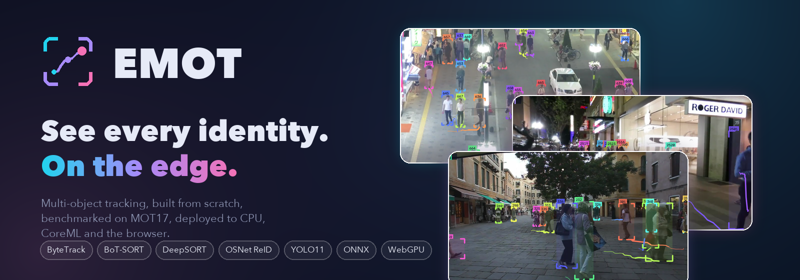
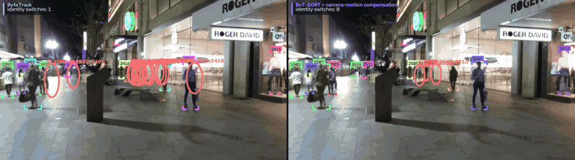

# EMOT -- edge multi-object tracking

Multi-object tracking built from scratch, benchmarked on real surveillance video, squeezed through ONNX / INT8 / CoreML for
edge deployment, and running **live in your browser**.

[:material-rocket-launch: Open the live web app](../){ .md-button .md-button--primary }
[:material-github: Source](https://github.com/fragompul/edge-multi-object-tracking){ .md-button }

## Start here

- [Quickstart](quickstart.md) -- track a video in three commands
- [Results](results.md) -- 294 runs, HOTA / IDF1 / MOTA, ablations
- [Edge deployment](edge.md) -- what ONNX, INT8, CoreML, threads and input size really buy
- [Trackers](trackers.md) and [Architecture](architecture.md)
- [Analytics & agent](analytics.md) -- from tracks to answers
- [Privacy & ethics](privacy-and-ethics.md) -- the safe path is the default
- [Limitations](limitations.md) -- what this does *not* claim

