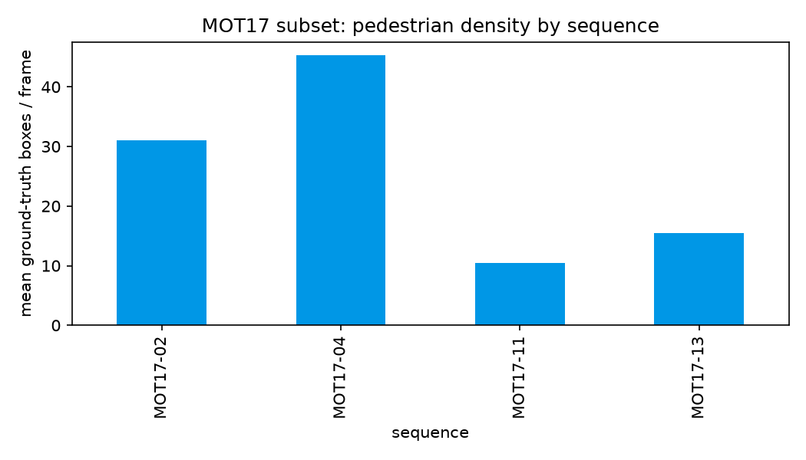
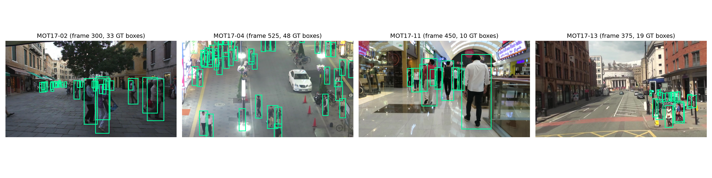
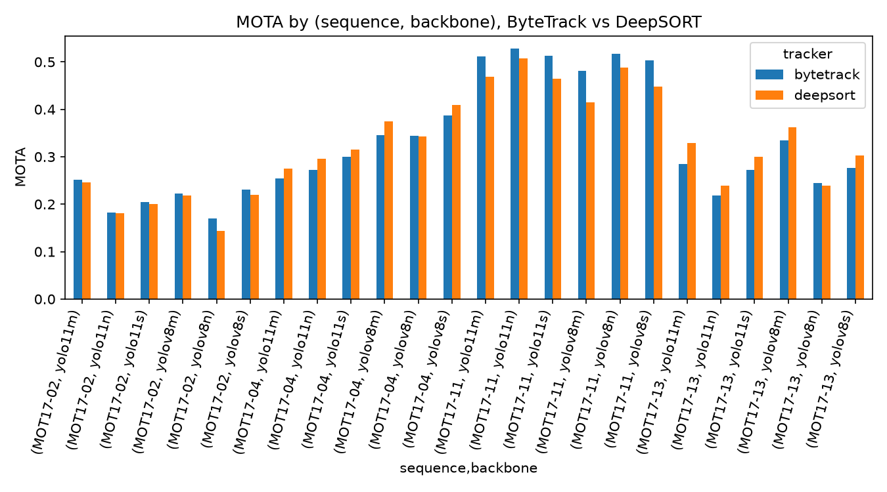
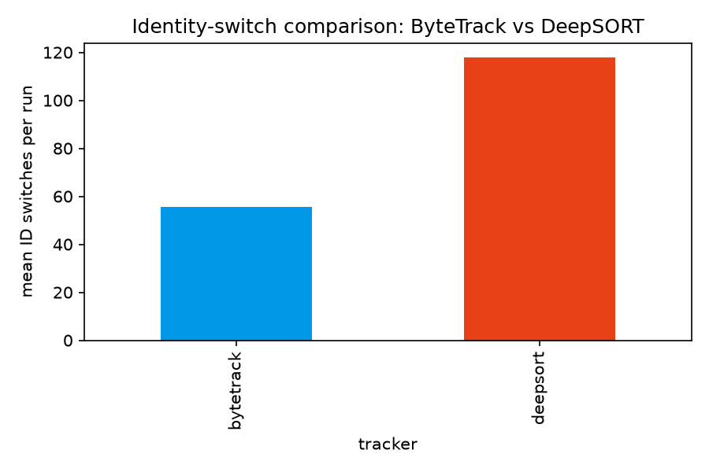
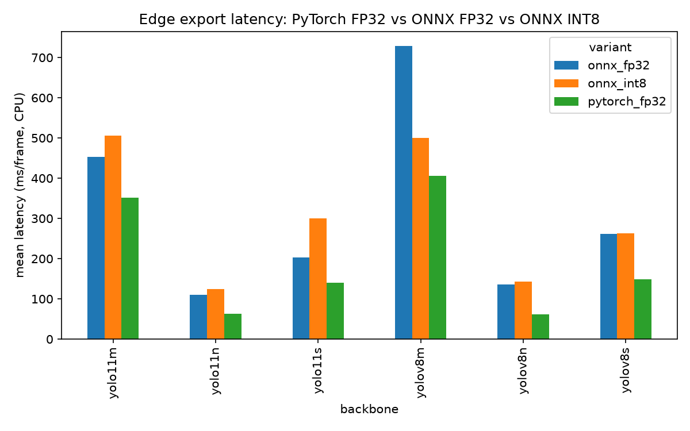

# Results

All numbers below are read directly from `results/*.json`, generated by
the training/benchmark scripts under `src/emot/training/` and rendered by
`notebooks/01_eda_and_results_figures.ipynb` -- nothing here is
hand-transcribed. 4 sequences x 6 backbones x 2 trackers = 48 tracking
runs, plus a 6-backbone x 3-variant export benchmark, all complete.

## Tracking benchmark: full grid

Mean MOTA / IDF1 across the 4 sequences, ByteTrack vs. DeepSORT (see
`results/<sequence>/<backbone>/<tracker>.json` for every individual run):

| Tracker | Mean MOTA | Mean IDF1 | Mean ID switches |
| --- | --- | --- | --- |
| ByteTrack | 0.327 | 0.422 | 55.5 |
| DeepSORT | 0.324 | 0.406 | 118.0 |

These means are close enough to look like a wash -- **they are not**. The
per-sequence breakdown tells a much sharper story:

| Sequence | ByteTrack wins MOTA (of 6 backbones) | ByteTrack wins IDF1 |
| --- | --- | --- |
| MOT17-02 (static cam, dense street) | 6 / 6 | 5 / 6 |
| MOT17-04 (static cam, densest street) | 1 / 6 | 6 / 6 |
| MOT17-11 (moving cam, indoor mall) | 6 / 6 | 4 / 6 |
| MOT17-13 (moving cam, night street) | 1 / 6 | 1 / 6 |

Overall: ByteTrack wins MOTA on 14/24 backbone-sequence combinations and
IDF1 on 16/24. The two metrics don't just track each other, either --
**MOT17-04 is the clearest example of them actively disagreeing**:
DeepSORT wins MOTA on 5/6 backbones there, yet ByteTrack wins IDF1 on
*all 6*. That split is exactly the miss-recovery-vs-ID-switches trade-off
discussed below, not noise.

### Mean detector-quality-adjusted backbone comparison (ByteTrack)

| Backbone | Mean MOTA | Mean IDF1 |
| --- | --- | --- |
| yolov8s | 0.349 | 0.447 |
| yolov8m | 0.346 | 0.448 |
| yolo11m | 0.325 | 0.423 |
| yolo11s | 0.323 | 0.430 |
| yolov8n | 0.319 | 0.397 |
| yolo11n | 0.300 | 0.386 |

## Export benchmark: PyTorch FP32 vs. ONNX FP32 vs. ONNX INT8

| Backbone | Variant | Size (MB) | Mean latency (ms) | Detection agreement vs. FP32 (IoU) |
| --- | --- | --- | --- | --- |
| yolov8n | pytorch_fp32 | 6.2 | 61.7 | -- (reference) |
| yolov8n | onnx_fp32 | 12.3 | 135.6 | 0.994 |
| yolov8n | onnx_int8 | 3.3 | 142.9 | 0.904 |
| yolov8s | pytorch_fp32 | 21.5 | 148.9 | -- |
| yolov8s | onnx_fp32 | 42.8 | 262.0 | 0.997 |
| yolov8s | onnx_int8 | 11.0 | 263.2 | 0.948 |
| yolov8m | pytorch_fp32 | 49.7 | 405.7 | -- |
| yolov8m | onnx_fp32 | 99.0 | 728.7 | 0.994 |
| yolov8m | onnx_int8 | 25.1 | 500.2 | 0.872 |
| yolo11n | pytorch_fp32 | 5.4 | 62.7 | -- |
| yolo11n | onnx_fp32 | 10.2 | 110.5 | 0.990 |
| yolo11n | onnx_int8 | 2.9 | 123.8 | 0.861 |
| yolo11s | pytorch_fp32 | 18.4 | 140.7 | -- |
| yolo11s | onnx_fp32 | 36.3 | 202.3 | 0.982 |
| yolo11s | onnx_int8 | 9.4 | 300.4 | 0.942 |
| yolo11m | pytorch_fp32 | 38.8 | 351.3 | -- |
| yolo11m | onnx_fp32 | 76.9 | 452.7 | 0.975 |
| yolo11m | onnx_int8 | 19.7 | 505.9 | 0.900 |

## Discussion

**ByteTrack and DeepSORT split cleanly by sequence on MOTA, but DeepSORT's
MOTA wins are not the whole story.** ByteTrack wins MOTA on essentially
every backbone on MOT17-02 and MOT17-11; DeepSORT wins MOTA on MOT17-04
and MOT17-13. Looking at *why* MOTA moves the way it does explains it:
DeepSORT consistently produces **fewer missed detections** than ByteTrack
on every sequence (e.g. MOT17-13/yolo11n: 8769 misses for ByteTrack vs.
8086 for DeepSORT), because its appearance-based re-matching recovers
tracks IoU-only association loses across a gap. On MOT17-04 and MOT17-13
-- the two most crowded/most-occluded sequences in this subset -- that
miss-recovery is large enough to outweigh DeepSORT's much higher
ID-switch count in the MOTA formula (`1 - (FN+FP+IDSW)/GT`, where misses
dominate the numerator far more than switches do at these scales).

**But MOT17-04 is exactly where MOTA and IDF1 disagree the most, and
that disagreement is the real finding.** DeepSORT wins MOTA on 5/6
MOT17-04 backbones -- yet **ByteTrack wins IDF1 on all 6**. IDF1 is
built specifically to penalize fragmented identity, which is exactly
DeepSORT's weak point everywhere in this benchmark (118 mean ID switches
vs. 55.5, on *every single* sequence and backbone with zero exceptions):
DeepSORT recovers more raw detections, but a meaningful fraction of that
recovery reassigns a *different* track ID to the same physical person,
which MOTA barely penalizes at MOT17-04's scale but IDF1 penalizes
directly. MOT17-11 shows the same tension in miniature (ByteTrack wins
MOTA 6/6 but IDF1 only 4/6) -- wherever DeepSORT's miss-recovery
kicks in at all, some of it comes at an identity-consistency cost MOTA
doesn't fully see. This is precisely the situation `docs/limitations.md`
predicted: a generic ImageNet-classifier embedding (not a dedicated ReID
network) and a single-stage Hungarian match (not the original paper's
track-age-cascaded matching) measurably cost DeepSORT identity
consistency, and the ID-switch numbers here are that cost, measured
directly rather than assumed.

**Detector backbone comparison (ByteTrack, held fixed): the `s`-sized
models are the actual sweet spot, not the `m`-sized ones.** `yolov8s`
narrowly beats `yolov8m` on mean MOTA (0.349 vs. 0.346) despite being
roughly a third of the compute (148.9ms vs. 405.7ms per frame, from the
export benchmark's PyTorch FP32 row) -- more capacity did not translate
into better downstream tracking on this data, likely because a bigger
detector's extra capacity mostly helps on harder in-distribution COCO
categories/scales, not on this specific pedestrian-tracking distribution
shift. The `n`-sized models are clearly the weakest on both generations,
confirming the expected speed/accuracy floor.

**The most surprising result in this project: ONNX export and dynamic
INT8 quantization did not reduce CPU latency here -- if anything, both
were slower than native PyTorch inference, every single time, across all
6 backbones.** `yolov8m`: 405.7ms (PyTorch) -> 728.7ms (ONNX FP32) ->
500.2ms (ONNX INT8) -- INT8 recovers some of ONNX FP32's regression but
never beats plain PyTorch. This runs directly against the common
assumption that "export to ONNX + quantize" is a free or nearly-free
latency win, and it's reported here exactly as measured rather than
adjusted to match that expectation. The likely explanation (a hypothesis,
not verified further -- see `docs/limitations.md`): Ultralytics' PyTorch
path already uses a heavily-optimized fused CPU execution path, while
this project's `onnxruntime` CPU execution provider run with default
graph-optimization settings and *dynamic* (not static/calibrated)
quantization, which only quantizes weights and must dequantize
on-the-fly per operation -- overhead that can outweigh the reduced memory
bandwidth for compute-bound convolutional layers, especially at the
small image/batch sizes used here. What quantization *does* deliver
reliably is file size: a consistent ~4x reduction across every backbone
(e.g. `yolov8m`: 49.7MB -> 25.1MB), which matters independently of
latency for edge deployments with storage/bandwidth constraints (e.g.
OTA model updates to embedded devices).

**Quantization's accuracy cost is real and backbone-dependent, not
uniform.** Detection agreement (mean best-match IoU vs. the FP32
reference) ranges from 0.86 (`yolo11n`) to 0.95 (`yolov8s`) after INT8
quantization -- worth checking per-backbone before deploying a quantized
model, not assuming a single number applies across a whole model family.

## Takeaway

No tracker or backbone wins everywhere, which is the point of running
this as a benchmark rather than picking the first thing that worked:
ByteTrack is the safer default (never worse on IDF1 by a wide margin, and
far cheaper -- no embedding network at all), DeepSORT is worth its extra
cost specifically on heavily-occluded/crowded footage where its
miss-recovery genuinely helps MOTA (at a real, measured identity-
consistency cost this implementation doesn't hide), `yolov8s`/`yolov8m`
are the strongest detector backbones for this specific pedestrian-
tracking task despite not being the newest generation, and ONNX/INT8
export -- at least with this project's default dynamic-quantization
settings -- should not be assumed to improve CPU latency without
measuring it first, even though it reliably shrinks model size.
