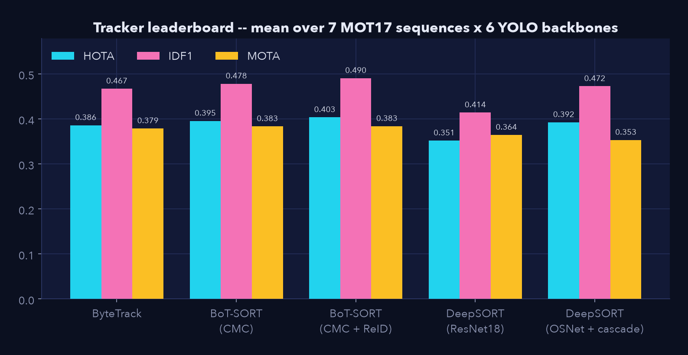
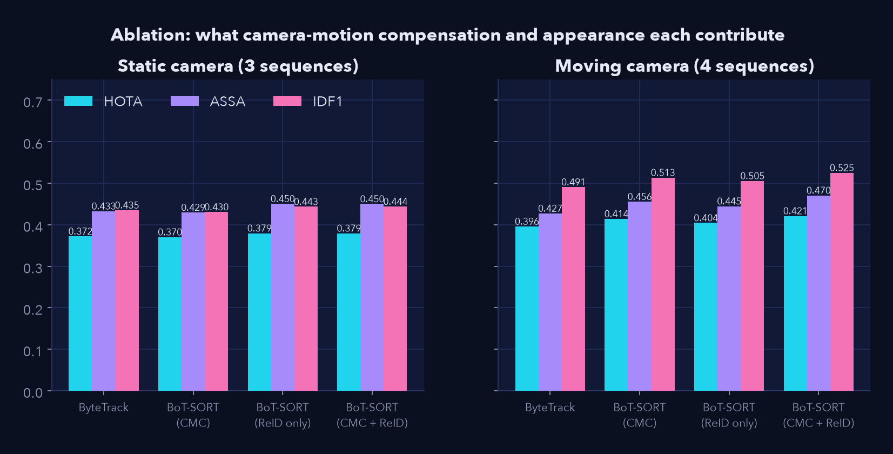
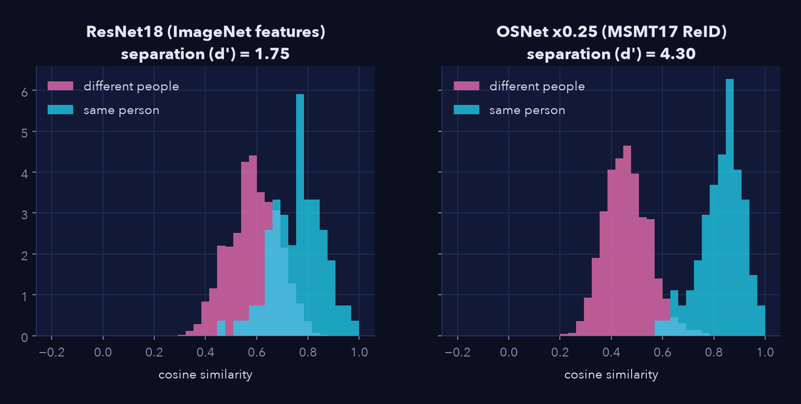
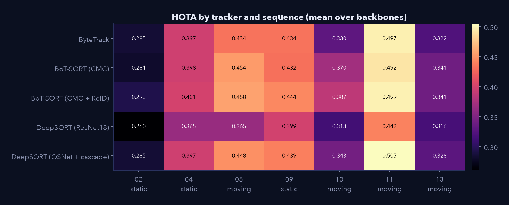
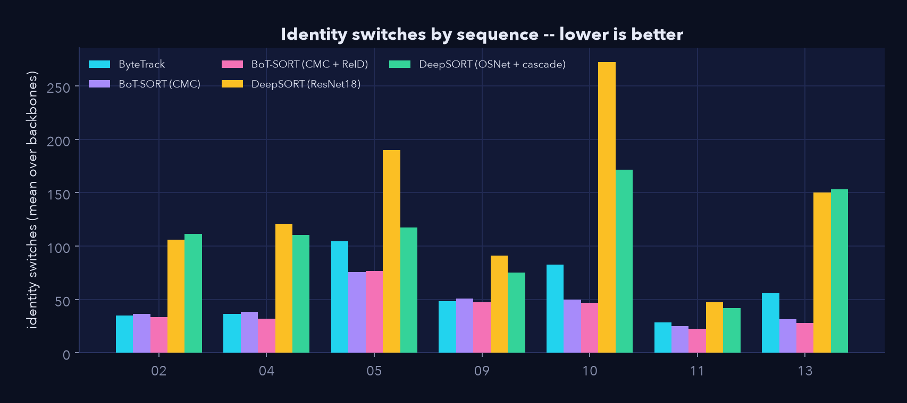
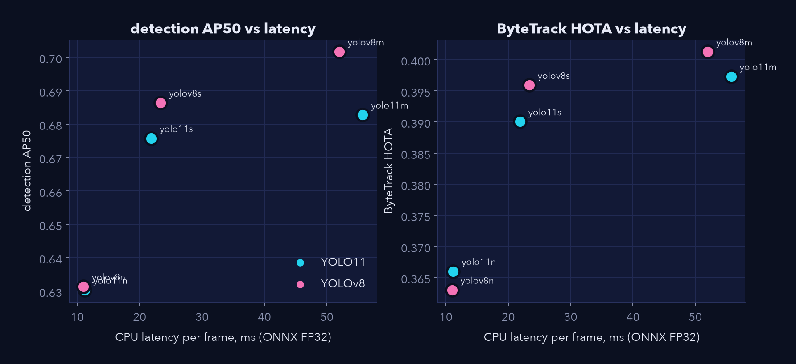

# Results

!!! note "Generated, not typed"
    Every number on this page is computed by `scripts/make_results_docs.py` from `results/*.json`.
    Protocol and limits: [Methodology](methodology.md), [Limitations](limitations.md).

**Scope:** 7 MOT17 sequences (3 static-camera, 4 moving-camera) x
6 YOLO backbones x 7 tracker variants = **294 tracking runs**,
all consuming the same cached detections, scored with HOTA, IDF1, MOTA and identity switches.

## Leaderboard

Mean over all sequences and backbones:

|  | HOTA | DetA | AssA | IDF1 | MOTA | ID switches |
| --- | ---: | ---: | ---: | ---: | ---: | ---: |
| BoT-SORT (CMC + ReID) | 0.403 | 0.364 | 0.462 | 0.490 | 0.383 | 41 |
| BoT-SORT (CMC) | 0.395 | 0.364 | 0.444 | 0.478 | 0.383 | 44 |
| BoT-SORT (ReID only) | 0.394 | 0.359 | 0.447 | 0.479 | 0.379 | 50 |
| DeepSORT (OSNet + cascade) | 0.392 | 0.369 | 0.426 | 0.472 | 0.353 | 112 |
| DeepSORT (OSNet) | 0.387 | 0.369 | 0.415 | 0.466 | 0.345 | 169 |
| ByteTrack | 0.386 | 0.359 | 0.429 | 0.467 | 0.379 | 56 |
| DeepSORT (ResNet18) | 0.351 | 0.362 | 0.355 | 0.414 | 0.364 | 140 |

Held-out check -- the trackers were tuned on MOT17-02, so here are the same means over the other six sequences:

|  | HOTA | DetA | AssA | IDF1 | MOTA | ID switches |
| --- | ---: | ---: | ---: | ---: | ---: | ---: |
| BoT-SORT (CMC + ReID) | 0.422 | 0.390 | 0.469 | 0.518 | 0.413 | 42 |
| BoT-SORT (CMC) | 0.414 | 0.390 | 0.454 | 0.505 | 0.412 | 45 |
| DeepSORT (OSNet + cascade) | 0.410 | 0.392 | 0.437 | 0.498 | 0.380 | 112 |
| BoT-SORT (ReID only) | 0.410 | 0.384 | 0.451 | 0.504 | 0.407 | 53 |
| DeepSORT (OSNet) | 0.407 | 0.393 | 0.429 | 0.492 | 0.371 | 173 |
| ByteTrack | 0.402 | 0.384 | 0.436 | 0.492 | 0.406 | 59 |
| DeepSORT (ResNet18) | 0.367 | 0.387 | 0.361 | 0.436 | 0.391 | 145 |

### By camera type

Static cameras (02, 04, 09):

|  | HOTA | DetA | AssA | IDF1 | MOTA | ID switches |
| --- | ---: | ---: | ---: | ---: | ---: | ---: |
| BoT-SORT (ReID only) | 0.379 | 0.335 | 0.450 | 0.443 | 0.344 | 36 |
| BoT-SORT (CMC + ReID) | 0.379 | 0.334 | 0.450 | 0.444 | 0.344 | 38 |
| DeepSORT (OSNet + cascade) | 0.374 | 0.342 | 0.420 | 0.433 | 0.316 | 99 |
| ByteTrack | 0.372 | 0.335 | 0.433 | 0.435 | 0.344 | 40 |
| BoT-SORT (CMC) | 0.370 | 0.334 | 0.429 | 0.430 | 0.343 | 42 |
| DeepSORT (OSNet) | 0.365 | 0.342 | 0.399 | 0.425 | 0.313 | 126 |
| DeepSORT (ResNet18) | 0.342 | 0.333 | 0.367 | 0.386 | 0.332 | 106 |

Moving cameras (05, 10, 11, 13):

|  | HOTA | DetA | AssA | IDF1 | MOTA | ID switches |
| --- | ---: | ---: | ---: | ---: | ---: | ---: |
| BoT-SORT (CMC + ReID) | 0.421 | 0.386 | 0.470 | 0.525 | 0.413 | 43 |
| BoT-SORT (CMC) | 0.414 | 0.386 | 0.456 | 0.513 | 0.413 | 46 |
| DeepSORT (OSNet + cascade) | 0.406 | 0.389 | 0.431 | 0.502 | 0.380 | 121 |
| BoT-SORT (ReID only) | 0.404 | 0.377 | 0.445 | 0.505 | 0.405 | 61 |
| DeepSORT (OSNet) | 0.404 | 0.390 | 0.427 | 0.497 | 0.368 | 201 |
| ByteTrack | 0.396 | 0.377 | 0.427 | 0.491 | 0.405 | 68 |
| DeepSORT (ResNet18) | 0.359 | 0.384 | 0.347 | 0.434 | 0.388 | 165 |

## What each component buys

| Question | Comparison | Mean HOTA change | Identity switches | Wins |
| --- | --- | ---: | ---: | ---: |
| Does camera-motion compensation help a moving camera? | BoT-SORT (CMC) vs ByteTrack, moving scenes | +0.018 | 68 -> 46 (-33%) | 20/24 |
| ...and a static one? | same, static scenes | -0.002 | -- | 5/18 |
| Does a real ReID network help DeepSORT? | OSNet vs ResNet18 embedding | +0.036 | -- | 40/42 |
| Does the matching cascade help? | OSNet + cascade vs OSNet single-stage | +0.005 | 169 -> 112 (-34%) | 30/42 |
| Everything together | BoT-SORT (CMC + ReID) vs ByteTrack | +0.018 | -- | 34/42 |

"Wins" counts (sequence, backbone) pairs where the first tracker scores better. Reading it:

- **Camera-motion compensation is a conditional win.** On the 4 moving-camera scenes it removes 33% of identity switches; on static scenes it changes HOTA by -0.002 -- the estimator measures ~0 px of motion and the warp is a near-identity.
- **A generic ImageNet embedding is a weak appearance cue.** Swapping in OSNet moves DeepSORT's HOTA by +0.036; the figure below shows why.
- **The cascade is about identity, not detection.** It changes DetA hardly at all but cuts switches by 34%.
- **BoT-SORT (CMC + ReID) vs ByteTrack:** AssA +0.032, DetA +0.005 -- the gain is entirely in association, as it should be, because detections are shared.
- **BoT-SORT vs the best DeepSORT:** +0.011 HOTA (29/42 pairs).

*Cosine similarity of embeddings for crops of the same person vs different people (ground-truth crops, frames 60-80 apart). The ReID network separates them far better than ImageNet features -- the mechanism behind the ablation above.*

## Per-sequence HOTA

|  | 02 (stat.) | 04 (stat.) | 05 (movi.) | 09 (stat.) | 10 (movi.) | 11 (movi.) | 13 (movi.) |
| --- | ---: | ---: | ---: | ---: | ---: | ---: | ---: |
| ByteTrack | 0.285 | 0.397 | 0.434 | 0.434 | 0.330 | 0.497 | 0.322 |
| BoT-SORT (CMC) | 0.281 | 0.398 | 0.454 | 0.432 | 0.370 | 0.492 | 0.341 |
| BoT-SORT (ReID only) | 0.296 | 0.400 | 0.444 | 0.442 | 0.336 | 0.511 | 0.326 |
| BoT-SORT (CMC + ReID) | 0.293 | 0.401 | 0.458 | 0.444 | 0.387 | 0.499 | 0.341 |
| DeepSORT (ResNet18) | 0.260 | 0.365 | 0.365 | 0.399 | 0.313 | 0.442 | 0.316 |
| DeepSORT (OSNet) | 0.273 | 0.390 | 0.447 | 0.433 | 0.336 | 0.504 | 0.329 |
| DeepSORT (OSNet + cascade) | 0.285 | 0.397 | 0.448 | 0.439 | 0.343 | 0.505 | 0.328 |

## Detector backbones

Detection quality (COCO-style AP against MOT17 ground truth, persons below 25% visibility treated as ignore regions) and downstream tracking, ByteTrack held fixed:

| Backbone | AP50 | AP | Recall@0.5 | HOTA (ByteTrack) | MOTA | IDF1 | CPU ms (ONNX) |
| --- | ---: | ---: | ---: | ---: | ---: | ---: | ---: |
| yolov8m | 0.702 | 0.409 | 0.769 | 0.401 | 0.386 | 0.487 | 52.0 |
| yolo11m | 0.683 | 0.403 | 0.737 | 0.397 | 0.393 | 0.486 | 55.8 |
| yolov8s | 0.686 | 0.392 | 0.751 | 0.396 | 0.388 | 0.482 | 23.4 |
| yolo11s | 0.676 | 0.388 | 0.738 | 0.390 | 0.375 | 0.466 | 21.9 |
| yolo11n | 0.630 | 0.355 | 0.691 | 0.366 | 0.355 | 0.439 | 11.2 |
| yolov8n | 0.631 | 0.359 | 0.689 | 0.363 | 0.374 | 0.442 | 11.0 |

## Input resolution vs. tracking quality

| Backbone | Input (px) | HOTA | MOTA | IDF1 | ID switches | AP50 | CPU ms |
| --- | ---: | ---: | ---: | ---: | ---: | ---: | ---: |
| yolo11m | 320 | 0.337 | 0.328 | 0.387 | 23 | 0.541 | 17.4 |
| yolo11m | 480 | 0.394 | 0.377 | 0.466 | 25 | 0.621 | 35.6 |
| yolo11m | 640 | 0.408 | 0.398 | 0.497 | 36 | 0.683 | 63.7 |
| yolo11m | 960 | 0.430 | 0.432 | 0.531 | 53 | 0.746 | 135.5 |
| yolo11m | 1280 | 0.443 | 0.391 | 0.541 | 64 | 0.761 | 240.1 |
| yolo11n | 320 | 0.289 | 0.261 | 0.324 | 26 | 0.454 | 4.0 |
| yolo11n | 480 | 0.339 | 0.335 | 0.396 | 35 | 0.561 | 8.2 |
| yolo11n | 640 | 0.375 | 0.359 | 0.453 | 41 | 0.630 | 13.0 |
| yolo11n | 960 | 0.401 | 0.406 | 0.491 | 61 | 0.716 | 26.1 |
| yolo11n | 1280 | 0.415 | 0.401 | 0.511 | 80 | 0.734 | 47.9 |
| yolo11s | 320 | 0.335 | 0.315 | 0.383 | 34 | 0.524 | 7.3 |
| yolo11s | 480 | 0.379 | 0.357 | 0.454 | 40 | 0.614 | 14.9 |
| yolo11s | 640 | 0.404 | 0.381 | 0.485 | 47 | 0.676 | 25.3 |
| yolo11s | 960 | 0.418 | 0.397 | 0.516 | 57 | 0.733 | 55.5 |
| yolo11s | 1280 | 0.426 | 0.380 | 0.515 | 69 | 0.753 | 99.1 |

**Pixels beat parameters.** `yolo11n` at 960 px matches `yolo11m` at the default 640 px (HOTA 0.401 vs 0.408; AP50 0.716 vs 0.683) at 2.4x lower CPU latency (26 vs 64 ms). MOT17's pedestrians are small, so pixels on target matter more than parameters.

Two caveats visible in the table: gains flatten (and MOTA can fall) at 1280 px as false positives grow, and **identity switches rise with resolution** -- the detector finds more, smaller people, so the tracker has more identities to keep straight. Resolution is a detection lever; association quality does not come for free with it.

## Tracker overhead

Association logic only (cached detections, embeddings and camera motion; those are costed in [Edge deployment](edge.md)):

| Tracker | Association cost (ms/frame) |
| --- | ---: |
| ByteTrack | 0.23 |
| BoT-SORT (CMC) | 0.35 |
| BoT-SORT (ReID only) | 0.28 |
| BoT-SORT (CMC + ReID) | 0.39 |
| DeepSORT (ResNet18) | 0.51 |
| DeepSORT (OSNet) | 0.61 |
| DeepSORT (OSNet + cascade) | 0.56 |

Every tracker's own logic is well under a millisecond per frame -- the detector, the ReID network and optical flow are what cost real time.
